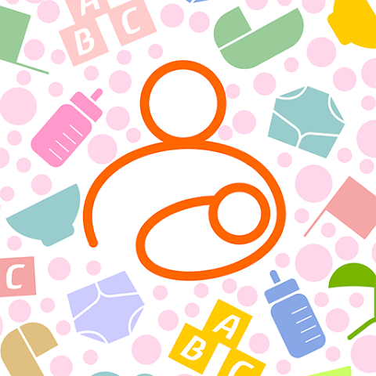

# Baby Tracker for Home Assistant

This custom component integrates the Baby Tracker app data with Home Assistant, allowing you to monitor and update your baby's activities through Home Assistant.

> **Unofficial.** This is an independent project, not affiliated with or endorsed by the makers of Baby Tracker. The sync protocol was worked out by the maintainer from how the official app talks to its server, and much of the code was then written with an AI coding assistant (Claude) working to that design, with the maintainer reviewing the results. It is tested against a faked copy of the sync server rather than certified against the real one. Treat it like any other hobby integration: read what it does before pointing it at your account, keep the app's own backups, and report anything odd.

## Features

- **Sensors for every baby**: feeding, diapers, sleep, nursing, bath, pumping, medicine, growth, milestones, doctor visits and vaccines, with the last record and 7-day totals
- **Insights and predictions**: next feed, next nap and expected wake, wake windows, milk intake against the baby's weight, diaper adequacy, and WHO growth percentiles. See [Insights](#insights)
- **Alerts**: feeding overdue, no poop, low wet diapers, fever, long sleep, feed due, sleep due and more, with thresholds you can set and a service to dismiss them
- **Household view, calendar and events**: sensors across all babies, a calendar and an Activity event entity per baby
- **Controls and nursing timer**: set a bottle size, bottle type, medicine and dose once, then log with one button; time nursing with Start and End buttons
- **Undo**: an Undo Last Entry button per baby, and `undo_last` and `delete_record` services
- **Photos**: each baby's photo and the latest picture as image entities, and photos added to entries from Home Assistant cameras and files
- **Sleep from another entity**: record sleep from a Snoo, an Owlet, a bed sensor or any other entity
- **Quiet mode**: alerts and predictions switch off for a child who is no longer logged for feeds or diapers
- **Services**: add every kind of record from Home Assistant, with an optional time for logging after the fact
- **Assist voice control**, and a short [Google Home](#google-home) note
- **Blueprints** for notifications
- **A Python library and command line** that talk to Baby Tracker without Home Assistant
- **Repairs and diagnostics** for sync problems

## Installation

### HACS (Recommended)

[](https://my.home-assistant.io/redirect/hacs_repository/?owner=isaiahnicolai&repository=baby-tracker-home-assistant&category=integration)

The button adds this repository to HACS and opens it there, so you only have to click **Download**. To do the same by hand:

1. Open HACS in your Home Assistant instance
2. Go to "Integrations"
3. Click the three dots in the top right corner
4. Select "Custom repositories"
5. Add the URL: `https://github.com/isaiahnicolai/baby-tracker-home-assistant`
6. Select "Integration" as the category
7. Click "Add"
8. Find and install "Baby Tracker" in HACS

### Manual Installation

1. Download the latest release from this repository
2. Copy the `custom_components/baby_tracker` folder into your `/config/custom_components/` directory (so you end up with `/config/custom_components/baby_tracker/manifest.json`)
3. Restart Home Assistant

Requires Home Assistant 2024.12 or newer.

### Set up

After a restart, add the integration and sign in with your Baby Tracker account:

[](https://my.home-assistant.io/redirect/config_flow_start/?domain=baby_tracker)

or go to **Settings > Devices & services > Add integration** and search for *Baby Tracker*. Signing in joins your account as a new device and fetches the seed database; the first refresh then replays the account's history, which takes a few seconds per few thousand records. See [Options](#options) for what you can change.

### Two or more babies

Each baby gets its own device with its own sensors and buttons (for example "Add Wet Diaper", "Add Dirty Diaper" and "Add Mixed Diaper"). Entity IDs follow `<domain>.<baby name>_<entity name>`, such as `sensor.ava_last_diaper`, `sensor.ava_weight`, `sensor.ava_last_feeding` and `button.ava_add_bottle`. The examples in this readme use a baby called Ava (and Ann Marie as a second baby); use your own baby's name.

All services take an optional `baby_name` (or the baby's device, from the **Baby** device picker). If you leave it out, the service uses the baby when there is only one, and refuses to guess when there are several. Pump sessions belong to the account rather than a baby.

### Using it from Python or the command line

The sync client in `custom_components/baby_tracker/client/` has no Home Assistant dependency and is packaged on its own as `babytracker-client`, so other scripts and projects can use it; its own readme is [custom_components/baby_tracker/client/README.md](custom_components/baby_tracker/client/README.md). Install it in any of these ways:

```bash
# the wheel attached to a release (no git needed)
pip install https://github.com/isaiahnicolai/baby-tracker-home-assistant/releases/download/v1.0.0/babytracker_client-1.0.0-py3-none-any.whl

# straight from the repository, at a tag or the main branch
pip install "git+https://github.com/isaiahnicolai/baby-tracker-home-assistant@v1.0.0"
# in a requirements.txt:  babytracker-client @ git+https://github.com/isaiahnicolai/baby-tracker-home-assistant@v1.0.0

# from a checkout, for development
pip install -e .
```

Add `[photos]` to the package (`pip install "babytracker-client[photos] @ git+https://github.com/isaiahnicolai/baby-tracker-home-assistant@v1.0.0"`) to be able to attach photos; it pulls in Pillow. The package needs Python 3.11 or newer and depends only on `requests` and `python-dateutil`.

That makes it importable as `babytracker_client` and adds a `babytracker` command:

```python
from babytracker_client import BabyTracker

tracker = BabyTracker(db_path="babytracker.db", time_zone="America/Chicago")
tracker.authenticate("you@example.com", "password", device_uuid="<a UUID you keep for this script>")
tracker.sync()
for baby in tracker.get_all_babies():
    print(baby.name, tracker.get_last_diaper(baby.object_id))
```

`BabyTracker` is the whole API. The main groups of methods:

- **Account**: `authenticate`, `sync`, `force_resync`, `pending_upload_count`, `get_all_babies`, `get_baby_by_name`, `download_baby_picture`.
- **Reading**: `get_last_<kind>` and `get_<kind>_records` for every record type (`get_last_diaper`, `get_last_feeding`, `get_last_sleep`, `is_currently_sleeping`, `get_growth_records`...), `get_recent_records`, `get_daily_summary`, `get_feeding_summary`, `get_sleep_analysis`, `get_events_between`, `get_pictures`, `get_latest_picture`.
- **Insights**: `get_insights` (corrected age, next feed, intake, diapers, growth percentiles, next sleep), `get_next_breast`, `get_next_medicine_dose`, `get_upcoming_milestones`, `get_upcoming_vaccines`, `get_pumped_milk_inventory`.
- **Writing**: `add_diaper`, `add_nursing`, `add_formula`, `add_pumped`, `add_other_feed`, `log_sleep_event`, `log_pump`, `log_growth`, `add_temperature`, `add_medicine`, `log_bath`, `add_activity`, `log_milestone`, `log_vaccine`, `log_doctor_visit`, `add_joy`, `attach_photo`, `delete_record`, `undo_last`.

Every write is stored locally first and uploaded by `sync` (which the write calls itself when the server is reachable), so a script can keep working offline. Each method's docstring describes its arguments; `tests/` shows every one in use.

```bash
export BABYTRACKER_EMAIL=you@example.com   # the password is asked for, or read from BABYTRACKER_PASSWORD
babytracker babies
babytracker last diaper --baby Ava
babytracker add-diaper wet --baby Ava
babytracker add-bottle --baby Ava --amount 4 --unit oz --type formula   # or --unit ml, --type pumped
babytracker add-nursing --baby Ava --left 10 --right 8                  # minutes per side
babytracker add-joy --baby Ava --note "First smile" --photo smile.jpg    # needs Pillow: pip install 'babytracker-client[photos]'
babytracker attach-photo Diaper <object-id> bath.png                        # add a photo to an existing entry
babytracker insights --baby Ava          # next feed, 24 hour intake, diapers, growth percentiles
babytracker next                            # each baby's predicted next feed, and who is due first
babytracker calendar --baby Ava --days 2 # feeds, sleeps, baths, visits and medicines
babytracker recent --baby Ava --limit 10 # newest records, with the type and ID `delete` takes
babytracker delete Diaper <object-id> --yes # delete a record on every device
babytracker undo --baby Ava --yes        # delete the newest record from the last day
babytracker inventory                       # pumped milk in store
babytracker create-medicine Tylenol --amount 2.5 --unit ml --interval 6   # add a medicine to the app's list
babytracker create-food Banana                                           # add a food to the solids list
babytracker devices
babytracker raw <device-uuid> --since 100   # decoded records exactly as the server sends them
```

Every command prints JSON. `--baby` is a baby's name and can be left out when the account has only one baby; `--offline` skips the sync that normally runs first.

Run `babytracker` with no command for an **interactive shell** (built on [cmd2](https://cmd2.readthedocs.io/)): it signs in and syncs once, then takes the same commands with tab completion for commands, options and baby names, `help` and `help <command>`, a history kept between sessions (up and down arrows, `history`), and `set baby Ava` so `--baby` can be left out. In the shell the commands are spelled with underscores (`add_diaper wet`), and the hyphenated spellings work too.

```
$ babytracker
Baby Tracker shell. Babies: Ava, Noah.
Type help for the commands, help <command> for its options, set baby <name> to pick a baby, quit to leave.
babytracker> set baby Noah
babytracker> add_diaper wet
babytracker> last feeding
babytracker> quit
```

Each client registers as its own device in the app. The CLI keeps its device ID and local database in `~/.babytracker`, separate from Home Assistant's.

### Development

[CONTRIBUTING.md](CONTRIBUTING.md) covers the layout, adding a record type and running the tests. In short, the repo follows Home Assistant's [integration blueprint](https://github.com/ludeeus/integration_blueprint) setup:

1. Open the repo in VS Code and choose **Reopen in Container** (needs Docker). The dev container installs Home Assistant, the test harness and the client package (`scripts/setup`).
2. `scripts/develop` starts Home Assistant on http://localhost:8123 with this integration loaded from the repo and debug logging on. Its data lives in `config/`, which is git-ignored apart from `configuration.yaml`.
3. `scripts/test` runs the test suite; `scripts/lint` formats and lints with ruff.

Without VS Code, the same Home Assistant runs from the pinned Docker image, preconfigured:

```bash
cp .env.example .env              # fill in your Baby Tracker login (.env is git-ignored)
docker compose up -d
python scripts/bootstrap          # finishes onboarding (user dev / dev) and adds Baby Tracker
```

Open http://localhost:8123. The integration is mounted from the repo, so `docker compose restart` picks up code changes. `scripts/bootstrap` also works against `scripts/develop`. It joins your account as a new device, like any other Home Assistant install.

Tests:

- `tests/` covers the sync client against the app's real database schema (`tests/fixtures/app_schema.sql`, no data) with the sync server faked. These need only pytest: `pip install -e . pytest tzdata && pytest tests --ignore=tests/ha` works anywhere, including Windows.
- `tests/ha` starts an in-memory Home Assistant with `pytest-homeassistant-custom-component`. It only runs on Linux/macOS (the dev container or CI), and each harness version matches one Home Assistant release: bump `requirements_test.txt` and `requirements.txt` together.

GitHub Actions runs both, plus hassfest and HACS validation.

## Available Sensors

After setting up the integration, the following entities will be created **for each baby**. States are numbers or timestamps (not text) wherever they can be, so history graphs, statistics and automations work on them directly. The details are in attributes: times of the record as text, notes, durations per side, and so on.

The integration's **Units** setting (imperial or metric, changeable in the options) decides how volumes, weights, lengths and temperatures are shown. Volumes, weights and lengths are stored as mL, kg and cm and displayed in fl oz, lb and in for imperial; you can still pick another unit in the entity's settings.

### Activity Sensors

| Sensor | State | Unit and class |
| --- | --- | --- |
| Last Feeding | Type of the last feeding: `nursing`, `formula`, `pumped` or `supplement` | enum |
| Last Feeding Time | When the last feeding was | timestamp |
| Last Diaper | Status of the last change: `wet`, `poopy`, `mixed` or `dry` | enum |
| Last Diaper Time | When the last diaper change was | timestamp |
| Last Sleep | Minutes slept, or so far if the baby is asleep now (the `sleeping` attribute says which) | min, duration |
| Last Sleep Time | When the last sleep started | timestamp |
| Last Nursing | Minutes of the last nursing session (left, right and both in attributes) | min, duration |
| Last Bath | Type of the last bath | text |
| Last Activity | Name of the last other activity, such as tummy time (`duration` in minutes and `time` in attributes) | text |
| Temperature | Most recent temperature, in the entry's unit | °F or °C, temperature |
| Time Since Last Feeding | Minutes since the last feeding; `feeding_status` and `needs_feeding` are attributes | min, duration |
| Next Feeding | Minutes until the age-based feeding limit (negative once overdue) | min, duration |
| Average Bedtime | Average night bedtime of the last two weeks, with a per-day list in the attributes | text |
| Daily Summary | Feedings so far today; formula, nursing minutes, diapers and sleep hours in attributes | feedings |

### Summary Sensors (Last 7 Days)

These are totals over a rolling 7 days (the `window_days` attribute says so), updated on every refresh.

| Sensor | State | Unit and class |
| --- | --- | --- |
| Feedings | Total number of feedings | feedings |
| Nursing Minutes | Total nursing time | min, duration |
| Bottle Volume | Formula and pumped milk from the bottle (oz equivalents in the attributes) | mL, volume |
| Diapers | Total diaper changes | diapers |
| Poopy Diapers | Dirty diapers, mixed ones included; `last_poopy_time` and `hours_since_last_poopy` in the attributes | diapers |
| Wet Diapers | Wet diapers, mixed ones included | diapers |

### Health & Growth Sensors

| Sensor | State | Unit and class |
| --- | --- | --- |
| Last Medicine | Name of the last medicine given | text |
| Last Pump | Total from the last pump session, whichever unit it was logged in | mL, volume |
| Pump Summary (diagnostic) | 7-day pumping total; sessions and durations in attributes | mL, volume |
| Weight | Most recent weight | kg, weight |
| Length | Most recent length/height | cm, distance |
| Head Circumference | Most recent head circumference | cm, distance |

### Milestone & Medical Sensors

| Sensor | State | Unit and class |
| --- | --- | --- |
| Last Milestone | Name of the most recent milestone | text |
| Last Doctor Visit | When the most recent doctor appointment or visit was | timestamp |
| Last Vaccine | Name of the most recent vaccine | text |

### Alerts, Night Mode and Housekeeping

- **Alerts** (`binary_sensor`): Feeding Overdue, No Poop, Low Wet Diapers, Fever, Long Sleep, plus the three insight alerts below. Their thresholds can be changed in the [options](#options)
- **Night Mode** (`binary_sensor`): on while the baby sleeps at night, 19:00 to 07:00 unless you change the [night hours](#options)
- **Nursing** (`binary_sensor`): on while a [nursing timer](#nursing-timer) is running
- **Info** (diagnostic sensor): the baby's age, with date of birth and other details in attributes
- **Photo** and **Photo Landscape** (`image`): the baby's photo from the app, and its wide version when the app has one. See [Photos](#photos)
- **Latest Photo** (`image`): the newest picture attached to any entry (a joy, diaper, bath, activity...), with `kind`, `time`, `note`, `object_type`, `object_id` and `picture_id` attributes and a `recent` list of the last ten pictures. Unknown until a picture exists
- **Recent Entries** (diagnostic sensor): the baby's newest records, with the type and ID that `delete_record` takes. See [Undoing a mistake](#undoing-a-mistake)
- **Sync Now** and **Force Resync** (configuration buttons on the *Baby Tracker* device)
- **Buttons** for quick logging: wet/dirty/mixed diapers, bath, start/end sleep, and the [controls and buttons](#controls-and-buttons) below (bottle, medicine, nursing timer, tummy time)
- **Fixed-size bottle buttons** (3 to 8 oz) and **Give Tylenol**: switched off by default, since *Add Bottle* and *Give Medicine* cover them; turn them on from the entity settings if you want them

### Photos

Each baby's photo is shown by its **Photo** image entity (for example `image.ava_photo`), for dashboards and picture cards. If the app also has a landscape (wide) version of the photo, the baby gets a **Photo Landscape** entity (`image.ava_photo_landscape`) too, which suits banner cards; it is created when the integration is set up, so reload it after adding a landscape photo in the app. The files are kept in a private `baby_tracker` folder in your Home Assistant configuration directory (photos attached to activities go in its `pictures` subfolder) and are only served through the image entity, which needs a login or the entity's access token. They are not under `www`, so nobody can fetch them without logging in.

#### Photos from Home Assistant

You can put photos on entries from Home Assistant, and they show on the phone app like any photo taken there. `baby_tracker.log_joy` logs a joy (the app's entry for a happy moment) and `baby_tracker.attach_photo` adds a photo to an entry that already exists (a diaper, a bath, an activity...; take its type and ID from the Recent Entries sensor). Both take the picture from one of:

- `photo`: a file path. It must be in the `baby_tracker` folder of your configuration folder, or in `www` or `media` (Home Assistant has to allow those two as external paths, which it does by default). Any other path is refused, so these services can't be used to send other files off your machine.
- `camera_entity`: a snapshot of a camera, taken when the service runs.
- `image_entity`: the current picture of an image entity.

The photo is stored as a JPEG with a thumbnail, uploaded to Baby Tracker before the entry is, and kept in the `pictures` subfolder. If the server can't be reached, the entry and its photo wait and go up on a later sync. Snapshots are written to a short-lived file in the private folder and deleted right away.

```yaml
automation:
  - alias: "Photo of the baby when the nursery door opens"
    triggers:
      - trigger: state
        entity_id: binary_sensor.nursery_door
        to: "on"
    actions:
      - action: baby_tracker.log_joy
        data:
          baby_name: "Ava"
          note: "Good morning!"
          camera_entity: camera.nursery
```

To add a snapshot to the diaper you just logged, find its ID in the Recent Entries sensor and call `baby_tracker.attach_photo` with `object_type: Diaper`, that `object_id` and a `camera_entity`. The Latest Photo entity and the Activity event's `photo` type then report it like any other new picture.

## Controls and Buttons

Each baby has a few settings that the logging buttons use, so a bottle of any size or any medicine is one tap:

| Entity (for Ava) | What it is |
| --- | --- |
| `number.ava_bottle_size` | How much the Add Bottle button logs. Ounces in 0.5 steps from 1 to 12 for an imperial entry; mL in steps of 10 from 30 to 360 for a metric one. Starts at 4 oz / 120 mL |
| `select.ava_bottle_type` | `formula` or `pumped`: which kind of bottle Add Bottle logs |
| `button.ava_add_bottle` | Logs a bottle of the Bottle Size, as formula or pumped milk (Bottle Type) |
| `select.ava_medicine` | Which of your account's medicines (the ones in the app) Give Medicine logs. Starts on the first |
| `number.ava_medicine_amount` | The dose Give Medicine logs, in 0.1 steps. Choosing a medicine sets it to that medicine's usual amount from the app (when it has one), and its `unit` attribute shows the medicine's unit. Give Medicine uses the usual amount if this is 0 or unset |
| `button.ava_give_medicine` | Logs a dose of the selected medicine |
| `number.ava_tummy_time_minutes` | How long Log Tummy Time logs. Starts at 15 |
| `button.ava_log_tummy_time` | Logs that much tummy time |
| `button.ava_undo_last_entry` | Deletes the baby's newest record from the last 24 hours. See [Undoing a mistake](#undoing-a-mistake) |

The settings are remembered across restarts. A bottle size saved in the other unit (after switching the entry between imperial and metric) is not reused. Under the same device you will also find the *Add Wet/Dirty/Mixed Diaper*, *Log Bath* and *Start/End Sleep* buttons.

A second press of the same button within 3 seconds is ignored (it is logged at info level), so a double tap or an automation that fires twice does not log a record twice. Logging a record asks for a refresh of the sensors, which Home Assistant spreads out if several come together.

A dashboard card for a baby:

```yaml
type: entities
title: Ava
entities:
  - select.ava_bottle_type
  - number.ava_bottle_size
  - button.ava_add_bottle
  - select.ava_medicine
  - number.ava_medicine_amount
  - button.ava_give_medicine
  - button.ava_log_tummy_time
```

### Undoing a mistake

**Undo Last Entry** (`button.ava_undo_last_entry`) deletes the newest record of any kind for that baby, as long as it is less than 24 hours old, and it is removed on your other devices too the next time they sync. It does nothing but report "Nothing to undo" when there is no such record, and a double tap deletes only one. Home Assistant logs what was deleted at info level, fires a `baby_tracker_undo` event on the bus and an `undo` event on the baby's Activity event entity.

The **Recent Entries** sensor (`sensor.ava_recent_entries`, a diagnostic entity) shows the newest record in its state, for example `wet diaper` or `formula 4 oz`, and the last ten in its `records` attribute, each with `object_type`, `object_id`, `time`, `kind` and `note`. Use the `object_type` and `object_id` with the [`delete_record` service](#undo-last-and-delete-record) to delete an older record.

### Nursing Timer

Like Start/End Sleep, the nursing buttons time a session and log it when it ends:

- `button.ava_start_nursing_left` and `button.ava_start_nursing_right` start the timer on that side. Pressing the other side while it runs switches over and keeps the time so far.
- `button.ava_end_nursing` stops the timer and logs one nursing record, dated when the session started, with the minutes spent on each side (at least one minute in total) and the side you finished on.
- `binary_sensor.ava_nursing` is on while a timer runs, with the `side` being nursed and `started_at` as attributes.

The running timer is kept in Home Assistant, not in the Baby Tracker app, so it is lost if Home Assistant restarts. If logging fails (for example, the server is down), the timer keeps running and you can press End Nursing again.

## Options

Choose **Configure** on the integration to change:

| Option | What it does |
| --- | --- |
| Update interval | Minutes between refreshes (default 15) |
| Units | Imperial or metric for volumes, weights, lengths and temperatures |
| Feeding overdue after (hours) | Feeding Overdue turns on this long after the last feeding. 0 (the default) uses the baby's age: 3.5 hours for a newborn, up to 6 for older babies |
| Wet diapers expected per day | Low Wet Diapers turns on after 8 pm when there have been fewer than this many (default 4) |
| Night starts at / Night ends at | The hours (0-23) Night Mode uses; default 19 and 7. Night can run past midnight |
| Fever temperature | Fever turns on at or above this, in the unit chosen above. Leave blank for 100.4 °F (38.0 °C) |

The options are saved as `scan_interval`, `unit_system`, `feeding_overdue_hours`, `low_wet_minimum`, `night_start_hour`, `night_end_hour` and `fever_threshold`. The integration reloads when you save them. After these, a **Sleep source** step follows for each baby (see below).

### Sleep from a Snoo, Owlet or another entity

A baby's sleep can be recorded from another Home Assistant entity, such as the state sensor of a Snoo or an Owlet, a bed sensor or an `input_boolean`. It lands in Baby Tracker (and on the phone) like a sleep you logged by hand, with the note "From <the entity's name>".

For each baby the options flow asks for:

| Setting | What it does |
| --- | --- |
| Entity | The entity to follow. Leave it empty for no source |
| States that mean asleep | The entity's state values that mean the baby is asleep (default `on`, `asleep`, `sleeping`). Any other state means awake. Check the entity's states in **Developer Tools > States** rather than guessing: the core `snoo` integration's state sensor and the Owlet custom integration each use their own values, and they can differ between versions |
| A wake shorter than this does not end the sleep | Minutes (default 10). A baby who stirs and settles again is still in the same sleep |
| Never log a sleep shorter than this | Minutes (default 5). Nothing is logged for a sleep that did not last this long |

How it works: when the entity goes to an asleep state, the integration waits for the minimum, then starts a sleep dated when the entity went to sleep. When the entity leaves the asleep state it waits for the gap; if the baby has not gone back to sleep by then, the sleep ends, dated when the baby woke rather than when the gap ran out. `unavailable` and `unknown` are ignored: they neither start nor end a sleep. If Home Assistant restarts mid-sleep the sleep carries on; if the entity is already asleep when it starts, the sleep is counted from then.

A sleep logged this way is an ordinary sleep: you can still end it with **End Sleep**, or undo it, by hand. If a sleep is already in progress in Baby Tracker (you pressed **Start Sleep** yourself), no second one is started, and the entity's wake still ends it. A **Sleep Source** diagnostic binary sensor appears for each baby with a source: it is on while the integration counts the baby as asleep through the entity, with the attributes `source_entity`, `since` and `pending_end`.

The settings are saved in the `sleep_sources` option, keyed by baby ID, with `sleep_source_entity`, `sleep_source_asleep_states`, `sleep_gap_minutes` and `sleep_min_minutes` for each baby.

### When a baby outgrows the app

Once a child is no longer logged for feeds or diapers, the questions about them stop making sense: Feeding Overdue would stay on for months and Time Since Last Feeding would count up forever. So the integration works out, for each baby, which activities are still **tracked**: feeds, diapers, sleep, pumping, medicine, growth and temperature. An activity is tracked when something in it was logged in the last 14 days. A baby under 14 days old tracks everything, since nothing logged yet does not mean it stopped.

For an activity that is not tracked:

- its alerts (for feeds: Feeding Overdue, Feed Due, Wake To Feed, Intake Low; for diapers: No Poop, Low Wet Diapers; for sleep: Long Sleep, Sleep Due, Nap Running Long; for temperature: Fever) are off, with the attribute `reason: not_tracked`;
- its predictions and rates (Next Feed, Feed Interval, Intake, Intake Status, Time Since Last Feeding, Feeding Timer, Diaper Adequacy, Next Sleep, Expected Wake, Wake Window) read unknown, with the same attribute;
- the household sensors (Next Feed Baby, Last Fed Baby, Babies Asleep, Feeds Today) leave that baby out;
- Assist answers "Feeds aren't being tracked for Ava" to questions about it.

What was logged is kept: Last Feeding, Last Diaper and Last Sleep still show their old values, and the counts for today stay. Logging something again (by hand, button or voice) makes the activity tracked again at the next refresh. The baby's Info sensor shows the verdict in its `tracking` attribute, and `tracking_mode` says whether it is `auto` or `manual`.

To override the automatic choice, open **Configure**; the step for each baby has a **Tracked activities** field. Leave it on **Auto**, or pick the activities that should count (a baby set by hand stays that way until you set it back to Auto). It is saved in the `tracking` option as `{baby_id: [groups]}`; a baby left on auto is not listed. The other way to quiet a child entirely is to disable that baby's device in Home Assistant, which turns off all of its entities.

## Repairs

Problems you can act on show up on *Settings > Repairs*:

- **Baby Tracker records aren't reaching the server**: records logged in Home Assistant have stayed unsent for more than 3 refreshes in a row. They are kept and sent when the server accepts them; the repair clears once they have gone.
- **Baby Tracker account was reset**: the account was reset or recreated in the app, so the data here belongs to the old group and syncing has stopped. Press Force Resync. The repair clears after the next successful sync.
- **Install the Baby Tracker voice commands**: the Assist sentence file with your babies' names is missing or out of date. Confirm the repair to write it (see [Voice control](#voice-control-assist)).

Refreshes, service calls and button presses never write to the local database at the same time, and the database waits up to 10 seconds for a lock rather than failing.

## Insights

Alongside the raw logs, each baby gets a few derived entities. They are recalculated on every refresh from what you have logged, and show as unknown when there is not enough data (no weight, no feeds, and so on).

| Entity | What it shows |
| --- | --- |
| `sensor.<baby>_next_feed` | Timestamp of the next expected feed, from the median of recent feed intervals (day and night separately), with the interval, basis and sample size as attributes |
| `sensor.<baby>_feed_interval` | The usual time between feeds, in hours |
| `sensor.<baby>_next_sleep` | Timestamp when an awake baby will probably need sleep: the end of the last sleep plus their usual wake window. Unknown while asleep. Attributes: `awake_since`, `wake_window_hours`, `window_min_hours`, `window_max_hours`, `max_awake_hours`, `basis`, `sample_count`, `bucket`, `overdue` |
| `sensor.<baby>_expected_wake` | Timestamp when a sleeping baby is expected to wake, from the usual length of their sleeps. Unknown while awake. Attributes: `asleep_since`, `basis`, `sample_count`, `bucket` |
| `sensor.<baby>_wake_window` | How long the baby usually stays awake between sleeps right now, in hours. Attributes: `window_min_hours`, `window_max_hours`, `basis` |
| `sensor.<baby>_intake_24h` | Bottle milk (formula and pumped) over the last 24 hours, with the expected range for the baby's weight. Shown in fl oz when the integration is set to imperial units |
| `sensor.<baby>_intake_status` | `low`, `ok`, `high` or `unknown` against that range |
| `sensor.<baby>_diaper_adequacy` | `ok`, `low` or `unknown` for wet and dirty diapers in the last 24 hours, for the baby's age |
| `sensor.<baby>_weight_percentile`, `_length_percentile`, `_head_percentile` | Percentile of the latest measurement on the WHO growth standard (attributes give z-score and the 3rd, 50th and 97th percentile values in kg or cm) |
| `sensor.<baby>_weight_gain` | Grams per day between the latest two weights at least 5 days apart, with the expected range |
| `sensor.<baby>_corrected_age` | Age in days corrected for prematurity (diagnostic) |
| `binary_sensor.<baby>_intake_low` | On when intake status is `low` |
| `binary_sensor.<baby>_feed_due` | On once the predicted next feed time has passed |
| `binary_sensor.<baby>_wake_to_feed` | On when a young baby has gone past the longest sensible gap between feeds |
| `binary_sensor.<baby>_sleep_due` | Sleep Due: on when an awake baby has reached the end of their usual wake window (`next_sleep_at` has passed). Attributes: `next_sleep_at`, `awake_since`, `wake_window_hours` |
| `binary_sensor.<baby>_wake_overdue` | Nap Running Long: on when a sleeping baby is 30 minutes past the expected wake time. Attributes: `expected_wake_at`, `asleep_since` |

**Wake windows.** The sleep predictions work from how long your baby stays awake between sleeps. With at least 3 recent daytime wake windows (the gap from the end of one sleep to the start of the next, ignoring gaps over 8 hours) the window is their median; with fewer it is the middle of the typical range for the baby's age (corrected for prematurity). Either way it is kept inside that range, which runs from 35-60 minutes in the first month, 1-1.5 hours at 1-2 months, 1.25-2 hours at 3-4 months, 2-3 hours at 5-6, 2.5-3.5 hours at 7-9, 3-4 hours at 10-12, 4-6 hours at 13-18 months and 5-6 hours up to two. A sleep in progress is expected to end after the median of the baby's last six sleeps of the same part of the day (daytime is 07:00-19:00), or a typical length for the age with fewer than three. The `basis` attribute says whether the estimate came from `history` or the `age_default`.

The numbers rest on published guidance: roughly 150-200 ml of milk per kg of body weight per day (AAP and NHS feeding guidance, capped at 960 ml), the WHO Child Growth Standards for percentiles (read from the CDC's copy of the tables, bundled in `custom_components/baby_tracker/client/data`), and, for babies born before 37 weeks, age corrected for prematurity until 24 months as the AAP recommends. Feed timing, wake windows, diaper and weight gain ranges are rules of thumb, not measurements of your baby. **These entities are not medical advice and cannot diagnose anything.** Every baby is different; talk to your pediatrician or health visitor about any worry about feeding, sleep, diapers or growth. Sleep Due and Nap Running Long are guidance for planning the day, not a sign that anything is wrong.

The five binary sensors work like the other alerts: they can be dismissed with `baby_tracker.dismiss_alert` using their entity ID.

### Alerts that follow the clock

Feed Due, Wake To Feed, Sleep Due, Nap Running Long, Feeding Overdue, Night Mode, Time Since Last Feeding and Next Feeding depend on the time of day, not only on new records, so they are re-evaluated **every minute** rather than once per refresh. Feed Due turns on at the predicted time, and Sleep Due at the end of the wake window, even if the next refresh is fifteen minutes away. Every alert also has a `baby_name` attribute, handy in notification templates.

### Other derived sensors

These are worked out from the records the app already stores, on every refresh.

| Entity | What it shows |
| --- | --- |
| `sensor.<baby>_which_breast_next` | `left`, `right` or `unknown`: the side the last nursing or pump session did not finish on. It uses the app's own rule: the latest nursing session is compared with the latest pump session (inventory adjustments don't count) and the more recent one decides. Like the app, it looks at every baby's nursing, since the mother is the same. Attributes: `last_side`, `last_type` (`nursing` or `pump`), `last_time` |
| `sensor.<baby>_next_medicine_dose` | Timestamp when the baby's last medicine can be given again: the time it was given plus the interval set on that medicine in the app. Unknown when the medicine has no interval. Attributes: `medicine_name`, `amount`, `unit`, `last_given`, `interval_minutes` |
| `sensor.<baby>_upcoming_milestones` | Name of the next milestone the baby hasn't logged yet, youngest `for_age_months` first. Attributes: `count` and an `upcoming` list (the first ten) |
| `sensor.<baby>_upcoming_vaccines` | Name of the next vaccine the baby hasn't had, in the same way |

Upcoming milestones and vaccines are the app's own lists, ordered by the age in months each is expected at, minus what has been logged for that baby. Nothing says a baby is behind schedule: the first item is simply the first one not yet ticked off.

## Household view

The *Baby Tracker* device (the one with the Sync Now button) holds sensors that look across all your babies:

| Entity | What it shows |
| --- | --- |
| `sensor.baby_tracker_next_feed_due` | Timestamp of the earliest predicted next feed among the babies. Attributes: `baby` (whose it is) and `predictions` (every baby's predicted time) |
| `sensor.baby_tracker_next_feed_baby` | Name of the baby who is due to feed first |
| `sensor.baby_tracker_last_fed_baby` | Name of the baby fed most recently; the `time` attribute says when |
| `sensor.baby_tracker_babies_asleep` | How many babies are asleep now; the `babies` attribute lists them |
| `sensor.baby_tracker_feeds_today` | Feedings so far today across all babies; `per_baby` has each one's count |
| `sensor.baby_tracker_pumped_milk_inventory` | Pumped milk in store: everything pumped (including inventory adjustments you made in the app) minus everything fed from the pump, like the app's own inventory. Shown in the entry's volume unit. Can go negative if feeds were logged without the pumping |
| `sensor.baby_tracker_pending_uploads` (diagnostic) | Records logged from Home Assistant that the Baby Tracker server hasn't received yet |

## Calendar

Each baby has a calendar (for example `calendar.baby_name_calendar`) showing their feeds, sleeps, baths, doctor visits and medicines, so you can scroll back through a day or a week in the Calendar panel or a calendar card. A sleep lasts as long as it did (a sleep still in progress runs up to now); everything else is a 15-minute event. The calendar entity's own state is on while the most recent event is still running, and its message is that event.

## Event entities

Each baby has an **Activity** event entity (`event.baby_name_activity`). It fires when a refresh finds something new, with one of these event types: `feeding`, `diaper`, `sleep_start`, `sleep_end`, `bath`, `medicine`, `photo` (a new picture on any entry; `kind`, `time`, `object_type`, `object_id` and `picture_id` in the event) or `undo` (an entry was deleted with Undo Last Entry or the `undo_last` service). The details (type, time, medicine name and so on) are attributes of the event. In an automation:

```yaml
triggers:
  - trigger: state
    entity_id: event.baby_name_activity
    attribute: event_type
    to: sleep_end
```

The `baby_tracker_feeding`, `baby_tracker_diaper` and `baby_tracker_sleep` events are also fired on the event bus. Nothing fires on the first refresh after startup.

## Blueprints

Ready-made automations in [`blueprints/automation/baby_tracker`](blueprints/automation/baby_tracker). Import one with its button, or in Home Assistant go to **Settings > Automations & Scenes > Blueprints > Import Blueprint** and paste the file's address.

| Blueprint | What it does | Import |
| --- | --- | --- |
| Feed due notification | Notifies a phone when a baby's Feed Due turns on, with the baby's name in the message | [](https://my.home-assistant.io/redirect/blueprint_import/?blueprint_url=https%3A%2F%2Fgithub.com%2Fisaiahnicolai%2Fbaby-tracker-home-assistant%2Fblob%2Fmain%2Fblueprints%2Fautomation%2Fbaby_tracker%2Ffeed_due_notification.yaml) |
| Sleep due notification | Notifies a phone when a baby's Sleep Due turns on (an awake baby has reached the end of their usual wake window) | [](https://my.home-assistant.io/redirect/blueprint_import/?blueprint_url=https%3A%2F%2Fgithub.com%2Fisaiahnicolai%2Fbaby-tracker-home-assistant%2Fblob%2Fmain%2Fblueprints%2Fautomation%2Fbaby_tracker%2Fsleep_due_notification.yaml) |
| Wake to feed | Notifies a phone when a baby should be woken to eat | [](https://my.home-assistant.io/redirect/blueprint_import/?blueprint_url=https%3A%2F%2Fgithub.com%2Fisaiahnicolai%2Fbaby-tracker-home-assistant%2Fblob%2Fmain%2Fblueprints%2Fautomation%2Fbaby_tracker%2Fwake_to_feed.yaml) |
| Daily intake summary | At a time you choose, sends how much milk the baby has had in 24 hours (by default only when it is low) | [](https://my.home-assistant.io/redirect/blueprint_import/?blueprint_url=https%3A%2F%2Fgithub.com%2Fisaiahnicolai%2Fbaby-tracker-home-assistant%2Fblob%2Fmain%2Fblueprints%2Fautomation%2Fbaby_tracker%2Flow_intake_daily.yaml) |
| New photo notification | Notifies a phone with the picture attached when a baby gets a new photo (uses the Activity event and Latest Photo entities) | [](https://my.home-assistant.io/redirect/blueprint_import/?blueprint_url=https%3A%2F%2Fgithub.com%2Fisaiahnicolai%2Fbaby-tracker-home-assistant%2Fblob%2Fmain%2Fblueprints%2Fautomation%2Fbaby_tracker%2Fnew_photo_notification.yaml) |

The address pattern is `https://my.home-assistant.io/redirect/blueprint_import/?blueprint_url=<URL-encoded address of the blueprint file on GitHub>`. Each blueprint asks which baby's sensor to watch and which phone (a device with the Home Assistant app) to notify; create one automation per baby.

## Service Calls

All services support multi-baby tracking with an optional `baby_name` parameter.

Every service that adds a record (all of the ones below except the utility services) also takes an optional **`time`**: when it happened, for logging something afterwards. Without it the record is dated now. A time without a time zone is in Home Assistant's time zone. In the UI it is a date and time picker.

```yaml
service: baby_tracker.add_diaper
data:
  baby_name: "Your Baby Name"
  poo: true
  time: "2026-03-01 09:30:00" # Optional - an hour ago, say, instead of now
```

Where a service takes a unit (oz or ml, pounds or kilograms, inches or centimeters, Fahrenheit or Celsius) and you leave it out, it follows the integration's **Units** setting.

### Basic Activities

#### Add Diaper Change

```yaml
service: baby_tracker.add_diaper
data:
  baby_name: "Your Baby Name" # Optional - leave empty for first baby
  pee: true
  poo: false
  pee_color: 0 # Optional (0-5)
  poo_color: 0 # Optional (0-5)
  texture: 0 # Optional (0-5)
  amount: 2 # Optional (0-5)
  note: "Optional note"
```

#### Add Nursing Session

```yaml
service: baby_tracker.add_nursing
data:
  baby_name: "Your Baby Name" # Optional
  left_duration: 15 # Minutes
  right_duration: 10 # Minutes
  both_duration: 0 # Minutes
  finish_side: "Left" # "Left", "Right", or "Both"
  note: "Optional note"
```

#### Add Formula Feeding

```yaml
service: baby_tracker.add_formula
data:
  baby_name: "Your Baby Name" # Optional
  amount: 120 # Amount in ml (or oz if is_english_measure is true)
  is_english_measure: false # Optional (default: follows the Units setting)
  note: "Optional note"
```

#### Add Pumped Milk

```yaml
service: baby_tracker.add_pumped
data:
  baby_name: "Your Baby Name" # Optional
  amount: 90 # Amount in ml (or oz if is_english_measure is true)
  is_english_measure: false # Optional (default: follows the Units setting)
  note: "Optional note"
```

#### Add Temperature

```yaml
service: baby_tracker.add_temperature
data:
  baby_name: "Your Baby Name" # Optional
  temperature: 98.6
  is_fahrenheit: true # Optional (default: follows the Units setting)
  note: "Optional note"
```

### Additional Activities

#### Log Sleep

```yaml
service: baby_tracker.log_sleep
data:
  baby_name: "Your Baby Name" # Optional
  is_start: true # true starts a sleep, false ends the one in progress
  time: "2026-03-01 21:00:00" # Optional
  note: "Optional note"
```

#### Log Bath

```yaml
service: baby_tracker.log_bath
data:
  baby_name: "Your Baby Name" # Optional
  bath_type: "Bubble Bath" # Optional: "Bubble Bath", "Sponge Bath", "Shower", "Washed Hair"
  note: "Optional note"
```

#### Log Pump Session

```yaml
service: baby_tracker.log_pump
data:
  baby_name: "Your Baby Name" # Optional
  left_duration: 15 # Minutes
  right_duration: 15 # Minutes
  left_amount: 3.5 # ml or oz
  right_amount: 4.0 # ml or oz
  is_english_scale: true # true for oz, false for ml (default: follows the Units setting)
  note: "Optional note"
```

#### Log Medicine

```yaml
service: baby_tracker.log_medicine
data:
  baby_name: "Your Baby Name" # Optional
  medicine_name: "Vitamin D" # Must match a medicine in your Baby Tracker app
  amount: 1.0
  create: false # Optional: true creates the medicine first if the app has none of that name (its usual dose is set to the amount)
  note: "Optional note"
```

#### Create Medicine

```yaml
service: baby_tracker.create_medicine
data:
  name: "Vitamin D"
  amount: 1.0 # Optional: the usual dose each time
  unit: "ml" # Optional, for example ml, mg or drops
  interval_hours: 24 # Optional: hours between doses (0 for none)
  prescription: false # Optional
```

Adds a medicine to your account (it is not tied to a baby), and it syncs to the app. It does nothing if a medicine of that name already exists. A medicine created this way shows up in each baby's **Medicine** select, ready for Give Medicine, once Home Assistant refreshes.

#### Log Growth Measurement

```yaml
service: baby_tracker.log_growth
data:
  baby_name: "Your Baby Name" # Optional
  weight: 15.5 # lbs or kg
  length: 24.0 # inches or cm
  head: 16.5 # inches or cm
  is_english_weight_scale: true # true for lbs, false for kg (default: follows the Units setting)
  is_english_length_scale: true # true for inches, false for cm (default: follows the Units setting)
  note: "Doctor visit measurements"
```

#### Log Milestone

```yaml
service: baby_tracker.log_milestone
data:
  baby_name: "Your Baby Name" # Optional
  milestone_name: "First smile" # Must match a milestone in Baby Tracker
  note: "So adorable!"
```

**Available Milestones**: First smile, Raise head, Claps Hand, Slept through the night, First laugh, Babbles, Holds head steady, Rolls over, Sits without support, Crawls, Stands, First steps, First word, and more.

#### Log Doctor Visit

```yaml
service: baby_tracker.log_doctor_visit
data:
  baby_name: "Your Baby Name" # Optional
  is_appointment: true # true for scheduled appointment, false for sick visit
  visit_type: 0 # 0=General checkup, customize as needed
  note: "2-month checkup"
  doctor_note: "Everything looks great!"
  symptom: "" # Optional symptoms if sick visit
```

#### Log Vaccine

```yaml
service: baby_tracker.log_vaccine
data:
  baby_name: "Your Baby Name" # Optional
  vaccine_name: "DTaP" # Must match a vaccine in Baby Tracker
  note: "2-month vaccines"
```

**Available Vaccines**: HepB, RV (Rotavirus), DTaP, Hib, PCV (Pneumococcal), IPV (Polio), Influenza, MMR, Varicella, Hep A, and more.

#### Log Activity

Tummy time and other activities. If your account already has an activity of that name it is reused; otherwise a new one is created.

```yaml
service: baby_tracker.log_activity
data:
  baby_name: "Your Baby Name" # Optional
  activity_name: "Tummy Time" # Optional (default: Tummy Time)
  duration: 15 # Minutes
  time: "2026-03-01 09:30:00" # Optional
  note: "Optional note"
```

#### Add Solids

```yaml
service: baby_tracker.add_solids
data:
  baby_name: "Your Baby Name" # Optional
  food_name: "Banana" # Must match a food in your Baby Tracker app's solids list
  amount: 2
  unit: "tbsp" # Optional
  is_english_measure: true # Optional (default: follows the Units setting)
  create: false # Optional: true creates the food first if the app's solids list has none of that name
  note: "First taste"
```

#### Create Food

```yaml
service: baby_tracker.create_food
data:
  name: "Mango"
  is_bottle: false # Optional: for a drink given from a bottle
```

Adds a food to the app's solids list. It does nothing if a food of that name already exists.

### Utility Services

#### Undo Last and Delete Record

```yaml
service: baby_tracker.undo_last
data:
  baby_name: "Your Baby Name" # Optional if you have only one baby (or pick the baby's device)
  within_hours: 24 # Optional: only undo a record this recent (default 24)
```

Deletes the baby's newest record of any kind, here and on the other devices. It fails with "Nothing to undo" if there is no record in that window.

```yaml
service: baby_tracker.delete_record
data:
  object_type: Diaper # Diaper, Nursing, Formula, Pumped, OtherFeed, Sleep, Temperature, Medication, Bath, Growth, Milestone, Vaccine, OtherActivity, Joy, Journal or DoctorVisit
  object_id: "0B1C2D3E-..." # From the Recent Entries sensor's records attribute
  baby_name: "Your Baby Name" # Optional: only used to report the deletion on that baby's Activity event
```

Deletes one record by type and ID. It fails with an error message if there is no such record.

#### Log Joy and Attach Photo

```yaml
service: baby_tracker.log_joy
data:
  baby_name: "Your Baby Name" # Optional if you have only one baby (or pick the baby's device)
  note: "First smile"
  camera_entity: camera.nursery # Optional photo: or photo: /config/baby_tracker/smile.jpg, or image_entity
```

```yaml
service: baby_tracker.attach_photo
data:
  object_type: Diaper # Any type delete_record takes except DoctorVisit
  object_id: "0B1C2D3E-..." # From the Recent Entries sensor's records attribute
  photo: /config/media/bath.jpg # Or camera_entity / image_entity (one of the three is required)
```

See [Photos from Home Assistant](#photos-from-home-assistant) for where a photo file may be.

#### List All Babies

```yaml
service: baby_tracker.list_babies
```

Returns a list of all babies with their names, IDs, dates of birth, and gender.

#### Manually Sync

```yaml
service: baby_tracker.sync
```

Manually triggers a sync with Baby Tracker servers.

#### Force Resync

```yaml
service: baby_tracker.force_resync
```

Deletes the local copy of the data and downloads everything again, for when the sync group was reset in the app. Records that were never uploaded are sent first; if that fails nothing is deleted. The **Force Resync** button does the same.

#### Dismiss Alerts

```yaml
service: baby_tracker.dismiss_alert
data:
  baby_name: "Your Baby Name" # Optional
  alert_type: feed_due # Optional: feeding_overdue, no_poop, low_wet_diapers, fever, long_sleep, intake_low, feed_due, wake_to_feed, sleep_due or wake_overdue
  entity_id: binary_sensor.ava_feed_due # Optional - dismiss one alert by its entity
```

Dismissed until the condition clears and comes back. `baby_tracker.dismiss_all_alerts` dismisses every active alert (a baby's, with `baby_name`).

The fixed-size bottle services (`add_4oz_bottle`, `add_6oz_bottle`, `add_8oz_bottle`, `add_small_bottle`, `add_medium_bottle`, `add_large_bottle` and `add_xlarge_bottle`) log a formula bottle of that size. For any other size use `add_formula` or the Add Bottle button.

## Voice control (Assist)

Home Assistant's Assist (the voice assistant on phones, satellites and the dashboard, and any voice or text pipeline that uses Home Assistant's own conversation agent) can log things and answer questions about your babies. Say the baby's name as it is in the Baby Tracker app. With only one baby you can leave the name out; with several, leave it out and Assist asks *Which baby?*

**Logging**

| Say | What it does |
| --- | --- |
| "Ava had a wet diaper", "log a dirty diaper for Ava", "Ava pooped" | Logs a wet, dirty, mixed or dry diaper |
| "log a 120 ml bottle for Ava", "Ava drank 4 ounces of pumped milk", "I gave Ava a 4 oz formula bottle" | Logs a bottle of formula or pumped milk. Without a unit it is in the unit chosen for the integration; without a type it is the baby's Bottle Type |
| "Ava is asleep", "Ava went to sleep", "start a nap for Ava" | Logs the start of a sleep |
| "Ava woke up", "end Ava's nap" | Ends the sleep in progress |
| "start nursing Ava on the left", "Ava is nursing on the right side" | Starts the nursing timer on a side (the other side switches the timer) |
| "stop nursing Ava", "Ava is done nursing" | Logs the session, dated when it started |
| "log a temperature of 98.6 for Ava", "Ava's temperature is 37.2" | Logs a temperature. 90 to 110 is taken as Fahrenheit and 34 to 43 as Celsius, whatever the units setting |

**Questions**

| Ask | Answer |
| --- | --- |
| "when did Ava last eat", "when was Ava's last feed" | "Ava last ate 2 hours ago, a 4 oz bottle." |
| "when was Ava's last diaper change" | "Ava's last diaper was wet, 45 minutes ago." |
| "when is Ava's next feed" | The predicted time from the [insights](#insights) |
| "when should Ava nap", "when is Ava's next nap", "when will Ava wake up" | "Ava has been awake for 1 h 20 min; the next nap is expected around 3:15 PM, in 25 minutes." Or, when asleep, "Ava has been asleep for 40 minutes and is expected to wake around 3:40 PM." |
| "how much has Ava eaten today", "is Ava eating enough" | The last 24 hours of intake against the expected range |
| "is Ava sleeping", "is Ava awake", "how long has Ava been asleep" | Asleep since, or awake since |
| "how is Ava doing", "baby status" | A short status: last feed, last diaper, sleep and next feed (every baby when none is named) |

The sentences are in the English file `custom_components/baby_tracker/custom_sentences/en/baby_tracker.yaml`. Home Assistant only reads sentence files from `<config>/custom_sentences/<language>/`, and the file needs your babies' names, so there is a one-time step: after the integration is set up, a repair appears in *Settings > Repairs* ("Install the Baby Tracker voice commands"). Select it and confirm, and the integration writes `<config>/custom_sentences/en/baby_tracker.yaml` with your babies' names filled in, then asks the conversation agent to reload. If a command is not recognised straight away, restart Home Assistant. Nothing is written to your configuration folder until you confirm. The repair comes back when a baby is added or renamed, or if the file changes, so the names stay current.

Assist can only run the sentences if its language is English and Home Assistant's own conversation agent handles them. With an AI conversation agent that has *Control Home Assistant* turned on, the same actions are available to it as tools (`BabyTrackerLogDiaper`, `BabyTrackerLastFeed` and so on) without the sentence file.

## Google Home

Home Assistant's Google Assistant integration can expose buttons and scripts to Google Home, so you can log with a voice command or a routine. Assist (see [Voice control](#voice-control-assist)) does the same without Google.

1. Set up the Google Assistant integration in Home Assistant and expose the entities you want.
2. Expose the **Add Wet Diaper**, **Add Dirty Diaper** and **Add Bottle** buttons, or a script like the one below. Set the Bottle Size and Bottle Type controls once; Add Bottle then logs that bottle every time.
3. In the Google Home app, create a routine whose command ("log a dirty diaper") activates the button or script.

A script that logs a bottle of a set size:

```yaml
script:
  log_bottle_6oz:
    alias: Log 6 oz bottle
    sequence:
      - action: baby_tracker.add_formula
        data:
          baby_name: "Ava"
          amount: 6
          is_english_measure: true
```

## Dashboard Card Examples

Cards to copy into a dashboard (replace `ava` with your baby's name).

An overview:

```yaml
type: entities
title: Ava
entities:
  - sensor.ava_last_feeding
  - sensor.ava_last_diaper
  - sensor.ava_last_sleep
  - sensor.ava_next_feed
  - sensor.ava_next_sleep
  - sensor.ava_temperature
  - binary_sensor.ava_feed_due
  - binary_sensor.ava_sleep_due
```

Quick actions, using the [controls](#controls-and-buttons):

```yaml
type: grid
columns: 3
square: false
cards:
  - type: button
    entity: button.ava_add_wet_diaper
  - type: button
    entity: button.ava_add_dirty_diaper
  - type: button
    entity: button.ava_add_bottle
  - type: button
    entity: button.ava_start_sleep
  - type: button
    entity: button.ava_end_sleep
  - type: button
    entity: button.ava_undo_last_entry
```

Two babies side by side:

```yaml
type: horizontal-stack
cards:
  - type: entities
    title: Ava
    entities:
      - sensor.ava_last_feeding
      - sensor.ava_last_diaper
      - sensor.ava_feedings
  - type: entities
    title: Ann Marie
    entities:
      - sensor.ann_marie_last_feeding
      - sensor.ann_marie_last_diaper
      - sensor.ann_marie_feedings
```

The photo entities also work in a picture card (`image.ava_photo`), and the [household sensors](#household-view) suit a card of their own.

## Automation Examples

For alerts, start with the [blueprints](#blueprints): they cover feed due, wake to feed, sleep due, new photos and a daily intake summary. Here are a few of your own.

Tell someone when the baby wakes up, using the Activity event entity:

```yaml
automation:
  - alias: "Ava woke up"
    triggers:
      - trigger: state
        entity_id: event.ava_activity
        attribute: event_type
        to: sleep_end
    actions:
      - action: notify.notify
        data:
          message: "Ava woke up"
```

Send a message when the fever alert turns on:

```yaml
automation:
  - alias: "Ava has a fever"
    triggers:
      - trigger: state
        entity_id: binary_sensor.ava_fever
        to: "on"
    actions:
      - action: notify.notify
        data:
          message: "Ava's temperature is {{ states('sensor.ava_temperature') }}. Call the doctor if you are worried."
```

Log a dirty diaper when a diaper bin sensor opens at night:

```yaml
automation:
  - alias: "Log a diaper from the bin"
    triggers:
      - trigger: state
        entity_id: binary_sensor.diaper_bin
        to: "on"
    conditions:
      - condition: state
        entity_id: binary_sensor.ava_night_mode
        state: "on"
    actions:
      - action: button.press
        target:
          entity_id: button.ava_add_dirty_diaper
```

These are conveniences, not medical advice. Talk to your pediatrician about any worry.

## Troubleshooting

- **Connection issues**: check that your Baby Tracker email and password are correct
- **Data not updating**: press **Sync Now** or call the `baby_tracker.sync` service
- **Records not reaching the app**: look at *Settings > Repairs* (see [Repairs](#repairs)) and press **Sync Now**
- **Missing data or database errors**: make sure Home Assistant can write to its configuration folder (see [Database Location](#database-location))
- **A button did nothing**: pressing the same button again within 3 seconds is ignored on purpose
- **Sensors not appearing**: restart Home Assistant after installing
- **More than one baby**: the `list_babies` service shows all babies and their names
- **Google Home not working**: check that the buttons or scripts are exposed in the Google Assistant configuration
- **Reporting a problem**: use **Download diagnostics** on the integration's page and attach the file to your issue. Your email, password and device ID are removed from it

## Privacy Notice

This integration stores your Baby Tracker credentials in Home Assistant to sync with the Baby Tracker servers. No data is sent to third parties. All data is stored in a local SQLite database in your Home Assistant configuration directory. Baby and activity photos are kept in a private `baby_tracker` folder there and are only shown by the image entities, which need a login.

## Database Location

The baby data is in `baby_tracker.db` in your Home Assistant configuration directory (`/config/baby_tracker.db` on most installs), and is synced with the Baby Tracker servers at the update interval.

## Support

Report a bug or ask for a feature in the [issue tracker](https://github.com/isaiahnicolai/baby-tracker-home-assistant/issues/new/choose). The bug form asks for your versions and logs. The diagnostics download hides your login, but check logs for your babies' names before posting. Report security problems privately, as [SECURITY.md](SECURITY.md) describes.

## Credits

This integration provides a local interface to the [Baby Tracker](https://www.baby-tracker.com/) app by Nighp Software, available for [Android](https://play.google.com/store/apps/details?id=com.nighp.babytracker_android) and [iOS](https://apps.apple.com/us/app/baby-tracker-newborn-log/id779656557). All trademarks, including the Baby Tracker name and logo, belong to their respective owners. It is an independent project and is not affiliated with or endorsed by the makers of Baby Tracker.

You need the app, with its sync feature set up, to use this integration: the account it signs in to is created in the app, and the records it reads and writes are your own. Sync is part of the free app; this integration is another device on an account you already have, and it does not unlock or work around any paid feature of the app (ad removal, Plus). The feed predictions, intake checks and growth percentiles here are this project's own calculations from your records, using published WHO and AAP guidance, not the app's.

The makers of Baby Tracker do not publish their sync protocol. The maintainer worked it out by studying how the official Android app talks to the server: the endpoints, the record formats, and the rules for merge order and conflicts. This client follows those same rules so that records stay consistent across your devices. It contains no code from the app. If the protocol changes, this integration may stop working until it is updated.

With that groundwork in place, much of the code was written with an AI coding assistant (Claude, via Claude Code), with the maintainer setting the direction, checking the work against the app's behaviour and reviewing the results. Bugs are the maintainer's responsibility, not the model's; please report them on the issue tracker.

The growth percentiles use the [WHO Child Growth Standards](https://www.who.int/tools/child-growth-standards/standards) (2006) for 0 to 24 months, as published by the US CDC. The tables are bundled unmodified in [`custom_components/baby_tracker/client/data`](custom_components/baby_tracker/client/data), which lists their sources.

## License

Released under the [MIT License](LICENSE). Copyright (c) 2026 Isaiah Nicolai. The bundled WHO growth data is not covered by this license: the CDC publishes its copy as US government work (public domain), and the underlying standards are the WHO's.
